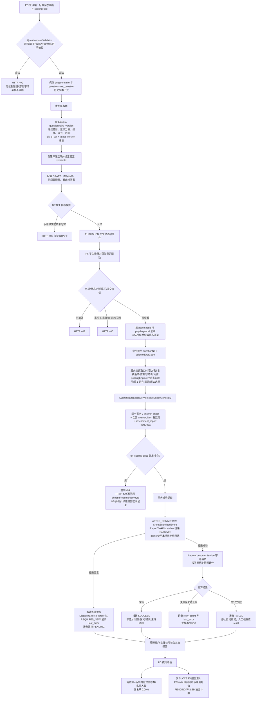

# 01 需求追踪与架构设计

> 项目：智慧心理健康评估系统（教学实训）  
> 对照基线：`SYSTEM_BLUEPRINT.md.md`、`docs/API_CONTRACT.md`、`init.sql`、`seed.sql`、后端实现与测试、PC/H5 页面源码  
> 实现口径：Spring Boot 3.3.5 / Java 17 / Vue 3 / UniApp H5 / MySQL 8.0、Redis 7、RabbitMQ 3.13；`demo` 模式使用 H2、缓存降级与本地异步线程池  
> 说明：早期蓝图建议过 JDK 21，当前可执行工程以 `backend/pom.xml` 的 `<java.version>17</java.version>` 为准。系统内账号、题目、分值和报告均为教学模拟内容，不作医学诊断。

## 1. 系统目标与设计主线

系统围绕“一份固定版本问卷、一场受控活动、一名学生一份有效答卷、一份可追溯异步报告”展开：

1. 管理员在 PC 端维护可编辑草稿；每次发布都生成新的不可变版本，而不是原地修改线上题目。
2. 活动绑定确定的 `questionnaire_version.id`，通过状态机、学生名单和开放时间窗共同控制参与资格。
3. 学生在 H5 端只读取脱敏后的冻结快照并提交选项编码，服务端独立完成合法性校验、正反向换算与有效分锁定。
4. 答卷主表、全部作答明细、初始 `PENDING` 报告在同一事务内落库；数据库唯一索引与预检共同兜底“一人一卷”。
5. 仅在提交事务成功后投递报告任务。异常投递不撤销有效答卷，错误单独持久化；消费端按快照计分、幂等跳过并受控重试。
6. 完成率统计有效答卷，结果区间与维度均值只统计 `SUCCESS` 报告，避免等待或失败任务污染统计。

## 2. 角色职责与数据访问边界

### 2.1 角色边界总表

| 业务对象 / 操作 | ADMIN（管理端） | STUDENT（参与端） | 服务端强制依据 |
| --- | --- | --- | --- |
| 登录、读取本人资料、修改本人资料 | 允许 | 允许 | `AuthService.login/getCurrentUser/updateProfile`；资料 ID 来自当前登录上下文，不接受任意用户 ID |
| 访问 `/api/admin/**` | 仅 `ADMIN` | 拒绝，HTTP 403 | `AuthInterceptor.preHandle` 角色拦截 |
| 访问 `/api/h5/**` | 拒绝，HTTP 403 | 仅 `STUDENT` | 同上；前端隐藏按钮不能替代服务端校验 |
| 问卷草稿、计分规则、发布版本 | 可查询与管理 | 不可访问 | `AdminQuestionnaireController` + 管理端角色校验 |
| 查看版本中的选项分值、正反向规则和区间 | 允许 | H5 填写页不返回这些字段 | PC `QuestionnaireVersionVO` 与 H5 `SanitizedQuestionVO/SanitizedOptionVO` 使用不同视图模型 |
| 活动列表 | 仅本人负责或被授权的活动 | 仅本人在名单内且非 `DRAFT` 的活动 | 管理员 `owner_id / authorized_admin_ids`；学生 `activity_participant` |
| 活动详情、改草稿、发布、关闭、统计、报告、缓存/运维接口 | 负责人或授权管理员可见并可按接口操作；未授权管理员 403 | 不可访问管理端接口 | `AccessControlService.checkAdminActivityAccess` + 角色拦截 |
| H5 活动固定版本与动态题目 | 通过管理端接口另行查看完整快照 | 仅名单内可读；名单外 403，草稿 400 | `SubmissionService.getH5ActivityDetail` |
| 提交答卷 | 不能代学生通过 H5 接口提交 | 仅本人、名单内、`PUBLISHED`、时间窗内且未交卷 | 实时活动行校验 + 名单校验 + `uk_submit_once` |
| 查看答卷记录 | 授权范围内通过统计明细和报告查看 | 仅 `user_id == currentUserId`；读他人 403 | `checkStudentRecordOwner` |
| 查看报告及重试 | 活动负责/授权管理员；可受控 `reset=true` | 仅本人报告；自助重试不允许重置计数 | `ReportAndStatsService.retryReportForAdmin/ForStudent` |
| 工作台与统计的数据范围 | 活动、有效答卷、异常报告按管理员可见活动汇总；问卷和版本总量为系统配置指标 | 无管理端工作台 | `ActivityService.getDashboardSummary`、`ReportAndStatsService.getActivityStatistics` |

### 2.2 示例账号对边界的验证价值

- `admin01` 是活动 1、2 的负责人；`admin02` 仅在活动 1 的 `authorized_admin_ids=[2]` 中；`admin03` 未获两项活动授权。
- `20260001`、`20260002`、`20260003` 在活动 1 的三人名单中；`20260004` 不在名单内。
- `20260001` 与 `20260002` 的预置答卷/报告可互相验证跨用户读取 403；`20260003` 用于现场产生第三份有效答卷。
- 因此，角色相同并不等于数据范围相同：三个管理员的行为差异用于验证“角色 + 活动授权”双层边界。

## 3. 应用架构与核心业务流程

### 3.1 必须保持的工程不变量

| 不变量 | 具体实现 | 被破坏时的后果 |
| --- | --- | --- |
| 历史快照不可随草稿变化 | `updateQuestionnaireDraft` 只改两张草稿表；`publishVersion` 另插冻结 JSON；活动、答卷、报告保存版本 ID | 历史题干、选项分值与报告无法复核 |
| 提交准入不能信前端、不能信旧缓存 | `submitAnswerSheet` 从数据库读取活动实时行，再校验名单、重复、状态和时间窗 | 已关闭活动可能被旧缓存“穿透”而继续收卷 |
| 主表、明细、初始报告原子写入 | `SubmitTransactionService.saveSheetAtomically` 的 `@Transactional(rollbackFor=Exception.class)` | 会出现无主明细、缺少报告或半份答卷 |
| 并发只能产生一份答卷 | 预检返回冲突 + `uk_submit_once(activity_id,user_id)` 硬约束 + 捕获 `DuplicateKeyException` | 一人多卷导致完成率、统计和报告失真 |
| 事务提交前不得发消息 | `SheetSubmittedEvent` 在事务内发布，但由 `@TransactionalEventListener(AFTER_COMMIT)` 消费 | 消费者可能读到尚未提交或随后回滚的答卷 |
| 异步故障不能撤销有效答卷 | 投递异常捕获并返回 `false`；`DispatchErrorRecorder` 独立新事务记录错误；消费失败写重试状态 | 学生已交卷却丢卷，或故障原因不可追查 |
| 报告任务必须幂等、重试必须有上限 | `assessment_report.sheet_id UNIQUE`、按 `sheetId` 加锁、`SUCCESS` 跳过、`max_retries=3` | 重复计算/覆盖生成时间或无限重试放大故障 |
| 分数分布不能混入未完成任务 | `getActivityStatistics` 只在 `SUCCESS` 分支累计区间与维度均值 | 待生成/失败被当成 0 分或某等级，统计口径错误 |

## 4. REQ01–REQ10 完整需求追踪矩阵

> “自动化验收测试方法”均使用实际 Java 方法名。`S` 代指 `ScoringEngineSevenSamplesTest`，`I` 代指 `SystemAcceptanceIntegrationTest`，`H` 代指 `HealthControllerTest`。一个参数化方法展开 7 次执行。状态表示源码已实现且有自动测试覆盖，不代表此处重新执行测试。

| 需求编号 | 功能名称 | 核心业务规则 | 后端实现类 / 方法 | PC / H5 前端页面 | 对应自动化验收测试方法 | 状态 |
| --- | --- | --- | --- | --- | --- | --- |
| REQ01 | 身份认证、个人资料与数据范围 | BCrypt 校验后签发 JWT；除登录/健康检查外均需令牌；ADMIN/STUDENT 分端；管理员按 owner/授权列表、学生按名单和本人 ID 控制数据 | `AuthService.login/getCurrentUser/updateProfile/listActiveUsers`；`JwtTokenProvider.generateToken/parseToken`；`AuthInterceptor.preHandle`；`AccessControlService.checkAdminActivityAccess/checkStudentInParticipantRoster/checkStudentRecordOwner` | PC `LoginView.vue`、`AdminLayout.vue`；H5 `pages/login/login.vue`、`pages/activity/list.vue`（资料弹窗与 403 自测） | `I.req01_missingOrInvalidTokenReturns401`；`req01_roleBoundaryReturns403`；`req01_adminDataScopeEnforcedForUnauthorizedAdmin`；`req01_studentCrossUserRecordReturns403`；`S.seedSqlPasswordHashMatchesPlain123456` | 已实现；5 项相关执行 |
| REQ02 | 问卷草稿与计分规则配置 | 当前支持 SINGLE；题号从 1 连续且唯一；每题至少 2 个选项；选项编码唯一、分值 0～100；维度公式 SUM/AVG；总分 SUM/AVG/SUM_DIMENSIONS；区间不得重叠；400 精确到字段 | `QuestionnaireValidator.validateUpsertRequest/validateQuestionsAndRule`；`QuestionnaireService.listQuestionnaires/getQuestionnaireDraft/createQuestionnaire/updateQuestionnaireDraft`；`AdminQuestionnaireController` | PC `QuestionnaireView.vue`：列表、草稿抽屉、题目/选项与规则页签、前端预校验；H5 不开放 | `I.req02_invalidQuestionnaireDraftRejectedWithPreciseErrors`（空题干、单选项、负分、重叠区间且均不落库）；`S.illegalAnswersAreRejectedWithPreciseLocation` | 已实现；2 项相关执行 |
| REQ03 | 发布与不可变版本快照 | 发布时冻结题目、选项分值、维度、公式、区间及 `ruleVersion`；版本号递增；`uk_q_ver` 防同问卷版本重复；草稿/v2 不改历史活动 v1 | `QuestionnaireService.publishVersion/listVersionsByQuestionnaire/listAllPublishedVersions/getVersionSnapshotCached`；`QuestionnaireVersionRepository.insertSnapshot` | PC `QuestionnaireView.vue`：发布弹窗、历史版本列表、结构化/JSON 快照预览；`ActivityView.vue` 固定版本选择；H5 填写页显示版本号 | `I.req03_publishedVersionSnapshotIsolatedFromLaterDraftAndPublish` | 已实现；1 项执行 |
| REQ04 | 活动状态机、名单与时间窗 | DRAFT→PUBLISHED→CLOSED 单向流转；仅草稿可改核心配置；发布要求有效版本、非空名单及 start<end；学生提交还需实时状态和时间窗；关闭立即失效活动缓存 | `ActivityService.createActivity/updateDraftActivity/publishActivity/closeActivity/getActivityDetailForAdmin/listAuthorizedActivitiesForCurrentAdmin`；`TimeStatusHelper.computeTimeWindowStatus/canStudentSubmit/validateActivityOpenForSubmit` | PC `ActivityView.vue`、`DashboardView.vue`；H5 `pages/activity/list.vue` 状态卡片、禁用按钮 | `I.req04_publishRejectedWhenRosterEmpty`；`req04_illegalStateTransitionsRejected`；`req04_studentOutsideRosterRejected403`；`req04_submitOutsideTimeWindowRejected400` | 已实现；4 项执行 |
| REQ05 | H5 活动查询、脱敏动态问卷与非法作答拦截 | 学生仅见名单内非草稿活动；详情读取固定版本；H5 选项仅 `optCode/label/sort`，同时不暴露 `dimensionCode/isReverse/score`；未知题号、重复题号、漏答、非法选项返回 400 且不落库 | `SubmissionService.listMyActivities/getH5ActivityDetail`；`ScoringEngine.calculate`；`QuestionnaireService.getVersionSnapshotCached` | H5 `pages/activity/list.vue`、`pages/survey/fill.vue`：动态排序、单选、必答定位、作答进度；PC 无参与权限 | `I.req05_h5DetailNeverExposesOptionScoreOrReverseFlag`；`req05_invalidAnswersRejectedWithoutPersisting`；并辅以 `S.illegalAnswersAreRejectedWithPreciseLocation` | 已实现；3 项相关执行 |
| REQ06 | 答卷事务提交、409 防重与个人记录 | 服务端算有效分；主表/明细/PENDING 报告同事务；`(activity_id,user_id)` 唯一；重复/并发返回 409 和原 IDs；记录/明细只读本人 | `SubmissionService.submitAnswerSheet/listMyRecords/getMyRecordDetail/buildConflictException`；`SubmitTransactionService.saveSheetAtomically`；`AnswerSheetRepository.insert/findByActivityAndUser`；`GlobalExceptionHandler.handleConflict` | H5 `pages/survey/fill.vue`：提交中禁用、409 弹窗“查看报告/查看记录”；`pages/record/list.vue` | `I.req06_submissionFaultInjectorRollsBackWholeOrder`（第 3 条明细前故障）；`req06_concurrentSubmitOnlyOneSuccessOthers409WithOriginalRecord`（9 并发=1×200+8×409） | 已实现；2 项执行 |
| REQ07 | 配置化正反向计分、维度与评估报告 | 正向取原分；反向=`reverseMaxPlusMin-原分`，缺省回退选项 max+min；分值两位小数、AVG 使用 HALF_UP；区间按开闭标志匹配；同快照同答案结果一致；历史 `ruleVersion` 可追溯 | `ScoringEngine.computeEffectiveItemScore/calculate/aggregate/matchLevel`；`ReportConsumerService.consumeReportTask`；`ReportAndStatsService.getReportForStudent/getReportForAdmin/buildReportDetailVO` | H5 `pages/report/report.vue`：三态、总分、维度、建议与溯源；PC `StatisticsView.vue` 报告详情 | `S.sevenFixedBoundarySamples`（7 次）；`levelBoundariesAreInclusiveAtBothEnds`；`exclusiveBoundsAndUnclassifiedGapAreRespected`；`forwardAndReverseScoreConversion`；`dimensionScoresForSeededAnswerSheets`；`avgTotalFormulaDividesEffectiveScoreSumByAnswerCount`；`avgDimensionFormulaComputesPerDimensionMean`；`sumDimensionsFormulaAggregatesDimensionScores`；`I.req10_duplicateConsumeIsIdempotentAndMatchesSyncScoring` | 已实现；15 项相关执行 |
| REQ08 | 完成率、三态报告与 ECharts 统计 | 完成数按名单内有效答卷统计；完成率两位小数、空名单 0.00；SUCCESS/PENDING/FAILED 分列；仅 SUCCESS 进入区间分布与维度均值 | `ActivityService.computeCompletionRate`；`AnswerSheetRepository.countParticipantCompletedByActivityId`；`ReportAndStatsService.getActivityStatistics`；`AssessmentReportRepository.countPendingOrFailedByActivityIds` | PC `StatisticsView.vue`：KPI、进度、区间柱/环图、维度柱/雷达图、名单状态、报告穿透与重试；`ActivityView.vue` 名单抽屉聚合统计交卷状态 | `I.req07_threeRosterTwoSheetsYields66_67Completion`；`req08_emptyRosterStatisticsReturnsZeroRateWithoutDivideByZero`；`req08_pendingAndFailedReportsExcludedFromLevelDistribution`；`S.dimensionScoresForSeededAnswerSheets` | 已实现；4 项相关执行 |
| REQ09 | 版本化热点缓存、观测与关闭防穿透 | 键为 `psych:qver:{versionId}`、`psych:act:{activityId}`；默认 TTL 1800s；记录 HIT/MISS_DB/EVICT、命中率和最近 50 条事件；发布/活动变更/关闭失效；提交永远实时查库；Redis 不可用时可降级内存 | `CacheService.getOrLoad/put/evictKey/evictAll/getMetrics/readRaw/writeRaw/handleRedisFallback`；`QuestionnaireService.getVersionSnapshotCached`；`ActivityService.closeActivity`；`AdminCacheAndOpsController.getCacheMetrics/evictCache` | PC `DashboardView.vue`：真实 `activeBackend/configuredMode/eventType` 映射、命中/回源/失效计数、事件流水、清缓存；H5 `pages/survey/fill.vue` 显示缓存来源 | `I.req09_firstReadMissesSecondReadHits`；`req09_closedActivityIsRejectedEvenWhenStaleCacheStillExists` | 已实现；2 项执行 |
| REQ10 | 事务后异步报告、失败留痕、幂等与受控重试 | AFTER_COMMIT 后 RabbitMQ 投递（demo 线程池）；投递失败答卷保留且独立事务记录错误；消费按 sheet 锁与 SUCCESS 状态幂等；重试至 3 次转 FAILED；管理员可显式 reset，学生不可 reset | `SubmitTransactionService.saveSheetAtomically`；`ReportTaskDispatcher.onSheetSubmittedAfterCommit/dispatch/dispatchRetry`；`DispatchErrorRecorder.record(REQUIRES_NEW)`；`ReportConsumerService.consumeReportTask/onRabbitMessage`；`ReportAndStatsService.executeControlledRetry`；`AdminCacheAndOpsController.getMqStatus/configureMqFault` | H5 `pages/report/report.vue`：PENDING 每 1.5s 最多 15 次轮询、FAILED 重试提示；PC `StatisticsView.vue` 异常原因、重试与 reset 确认 | `I.req10_sendFailureKeepsSheetAndRecordsLastError`；`req10_consumeFailureRetriesUpToMaxThreeThenBoundedFailed`；`req10_duplicateConsumeIsIdempotentAndMatchesSyncScoring`；`req08_pendingAndFailedReportsExcludedFromLevelDistribution` | 已实现；4 项相关执行 |

> 注：矩阵中的“相关执行数”按需求交叉关系列出，不能跨行相加。全量去重结果为 `S=16 + I=22 + H=1 = 39` 次执行；另有 `H.healthReturnsUp` 验证 `/api/health` 的 200、`code=0`、`data.status=UP`。

## 5. 运行形态与架构职责分层

| 层次 | 组件 | 职责 | 不应承担的职责 |
| --- | --- | --- | --- |
| 表现层 | `pc-web/src/views`、路由、Pinia、Axios；`h5-app/src/pages`、`uni.request` | 表单交互、状态展示、Token 透传、409 引导、报告轮询、ECharts | 决定参与资格、计算可信得分、授权他人数据 |
| 接口层 | `AuthController`、`AdminQuestionnaireController`、`AdminActivityAndStatsController`、`H5AssessmentController`、缓存/健康控制器 | REST 路径、请求响应对象、HTTP 语义 | 编写核心事务和计分细节 |
| 安全层 | `AuthInterceptor`、`JwtTokenProvider`、`AccessControlService` | 401、角色 403、活动/名单/本人数据 403 | 用前端传入的角色或 userId 代替数据库身份 |
| 业务层 | `QuestionnaireService`、`ActivityService`、`SubmissionService`、`ReportAndStatsService` | 草稿/版本、活动、资格、统计、读取与重试 | 绕过限定数据范围直接拼装任意记录 |
| 核心可靠层 | `SubmitTransactionService`、`ReportTaskDispatcher`、`DispatchErrorRecorder`、`ReportConsumerService` | 原子提交、事务后事件、故障留痕、异步消费与重试 | 在提交回滚前投递 MQ；无限重试 |
| 规则层 | `QuestionnaireValidator`、`ScoringEngine`、`TimeStatusHelper` | 纯配置规则、确定性计分、时间窗判断 | 将某一份教学模拟卷写死成全局规则 |
| 数据/缓存层 | 9 个 Repository、`CacheService` | 参数化 JDBC、唯一约束落点、热点读穿、失效和指标 | 用缓存代替提交时实时状态；脱离事务写半份答卷 |

## 6. 与交付清单的对应关系

| 任务书交付类别 | 本仓库可交付材料 | 验收入口 |
| --- | --- | --- |
| 设计资料 | 本文的架构与需求追踪；`docs/02_数据模型与双端交互设计.md` 的 ER、数据字典、交互和权限设计；`docs/API_CONTRACT.md`；`SYSTEM_BLUEPRINT.md.md` | 随机抽 REQ 编号，可追到类/方法、页面和测试方法 |
| 工程与数据 | `backend/`、`pc-web/`、`h5-app/`、`init.sql`、`seed.sql`、`docker-compose.yml`、`.env.example` | 9 表核对、种子 3 人 2 卷、全端源码审查 |
| 运行与测试 | `docs/03_测试验收与缺陷回归记录.md`；3 个测试类；Surefire 报告；本文测试映射 | 根目录 `README.md` 的 `mvn test`；39 次执行证据 |
| 演示材料 | `docs/04_部署复现手册与答辩分工指南.md`；双模式启动、7 账号、5 分钟脚本、六人答辩卡片 | 干净环境复现 + 每名成员独立操作和解释一条链路 |

## 7. 验收时应优先抽查的四条证据链

1. **版本链**：`questionnaire.id → questionnaire_version.id/version_num → assessment_activity.questionnaire_version_id → answer_sheet.questionnaire_version_id → assessment_report.rule_version`。
2. **防重链**：H5 提交 → 业务预检 409 → `uk_submit_once` 并发兜底 → 9 线程只一份答卷 → H5 原报告跳转。
3. **事务链**：明细故障整单回滚 → AFTER_COMMIT 才投递 → 投递故障独立事务留错且答卷保留 → 受控重试与幂等。
4. **统计链**：名单作分母、有效答卷作完成数 → 空名单 0.00 → 报告三态分列 → 仅 SUCCESS 进入结果分布与维度均值。
