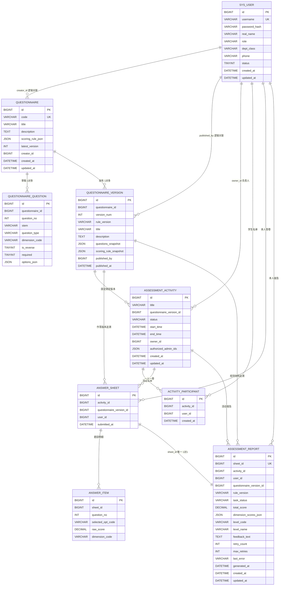
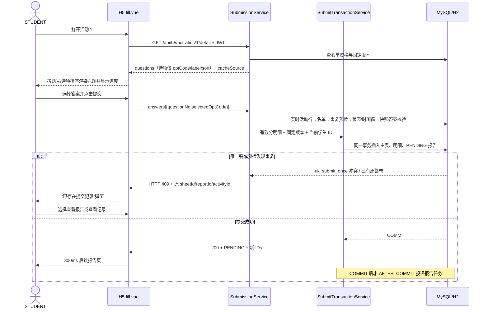

# 02 数据模型与双端交互设计

> 数据源：根目录 `init.sql`、`seed.sql`，`backend/src/main/resources/sql/schema-h2.sql`，Repository/Service/DTO 与 PC/H5 页面。  
> 目标：形成“9 张核心表 + 逻辑外键 + 唯一约束 + 事务边界 + 双端权限视图”的可评审设计。所有联系均通过 ID 字段在应用层维护，DDL **没有声明物理 FOREIGN KEY**。

## 1. 九张核心表 ER 关系图

> 导出的高清 ER 图（总览 / 问卷配置域 / 活动答卷域）与完整数据字典见 [`ER图.md`](./ER图.md)，图片源文件在 `docs/diagrams/`。



> `assessment_activity.authorized_admin_ids` 是管理员 `sys_user.id` 的 JSON 数组，表达“活动—多名协同管理员”的逻辑授权关系，但没有独立关联表，也不是数据库自关联外键。`uk_q_ver`、`uk_act_user`、`uk_submit_once`、`uk_sheet_q` 均为**复合唯一键**，不能由其中单列上的普通 `UK` 图例误读为“单列唯一”，准确范围见第 3 节。

## 2. 完整数据字典

约定：时间均为 `DATETIME`（H2 映射为 `TIMESTAMP`），金额型分值均为 `DECIMAL(8,2)`。`created_at`/`updated_at` 默认当前时间，MySQL 的 `updated_at` 还在更新时自动刷新；H2 对应更新语句显式设置 `CURRENT_TIMESTAMP`。

### 2.1 `sys_user` — 系统用户表（REQ01）

| 字段 | 类型 / 可空与默认 | 含义与约束 |
| --- | --- | --- |
| `id` | BIGINT，NOT NULL，AUTO_INCREMENT，PK | 用户主键；JWT subject 和业务数据归属依据 |
| `username` | VARCHAR(64)，NOT NULL，UNIQUE | 学号 / 工号，登录唯一标识 |
| `password_hash` | VARCHAR(128)，NOT NULL | BCrypt 哈希，不保存/返回明文密码 |
| `real_name` | VARCHAR(64)，NOT NULL | 姓名；资料维护必填且最长 64 字符 |
| `role` | VARCHAR(20)，NOT NULL | `ADMIN` 或 `STUDENT`，分端权限依据 |
| `dept_class` | VARCHAR(128)，NULL | 学院 / 班级，可用于名单筛选与展示 |
| `phone` | VARCHAR(32)，NULL | 联系电话；个人资料页可维护 |
| `status` | TINYINT，NOT NULL，DEFAULT 1 | 1 正常、0 禁用；禁用登录/继续访问返回 401 |
| `created_at` | DATETIME，NOT NULL，DEFAULT CURRENT_TIMESTAMP | 创建时间 |
| `updated_at` | DATETIME，NOT NULL，DEFAULT CURRENT_TIMESTAMP，ON UPDATE CURRENT_TIMESTAMP | 最近更新时间 |

### 2.2 `questionnaire` — 问卷可编辑主表（REQ02）

| 字段 | 类型 / 可空与默认 | 含义与约束 |
| --- | --- | --- |
| `id` | BIGINT，PK，AUTO_INCREMENT | 问卷主键 |
| `code` | VARCHAR(64)，NOT NULL，UNIQUE | 业务唯一编码；服务层校验非空、长度与重复 |
| `title` | VARCHAR(128)，NOT NULL | 草稿标题，发布时复制到快照 |
| `description` | TEXT，NULL | 指导语和教学模拟声明 |
| `scoring_rule_json` | JSON，NULL | 草稿态维度、总分公式、反向基数、结果区间及建议 |
| `latest_version` | INT，NOT NULL，DEFAULT 0 | 最新已发布版本号，0 表示未发布；发布成功后递增 |
| `creator_id` | BIGINT，NOT NULL | 逻辑引用 `sys_user.id` 的创建人 |
| `created_at` | DATETIME，NOT NULL，默认当前时间 | 创建时间 |
| `updated_at` | DATETIME，NOT NULL，默认当前时间并自动更新 | 草稿最后修订时间 |

### 2.3 `questionnaire_question` — 草稿题目与选项表（REQ02）

| 字段 | 类型 / 可空与默认 | 含义与约束 |
| --- | --- | --- |
| `id` | BIGINT，PK，AUTO_INCREMENT | 草稿题目主键 |
| `questionnaire_id` | BIGINT，NOT NULL | 逻辑引用 `questionnaire.id`；普通索引 `idx_q_sort` 首列 |
| `question_no` | INT，NOT NULL | 显示题号；应用层要求从 1 连续且同卷唯一 |
| `stem` | VARCHAR(500)，NOT NULL | 题干，校验非空 |
| `question_type` | VARCHAR(20)，NOT NULL，DEFAULT 'SINGLE' | 当前仅接受 `SINGLE`，DDL 注释预留 MULTI，但服务端尚不接受多选 |
| `dimension_code` | VARCHAR(64)，NOT NULL，DEFAULT 'DEFAULT' | 归属维度；若规则声明维度，必须在 `dimensions` 中 |
| `is_reverse` | TINYINT，NOT NULL，DEFAULT 0 | 0 正向、1 反向；反向有效分见计分引擎 |
| `required` | TINYINT，NOT NULL，DEFAULT 1 | 1 必答、0 选答 |
| `options_json` | JSON，NOT NULL | 选项数组：`optCode/label/score/sort`；每题至少两项、同题编码唯一、分值 0～100 |

索引：`idx_q_sort(questionnaire_id, question_no)` 是排序/查询索引，**不是唯一约束**；题号唯一与连续由 `QuestionnaireValidator` 保证。

### 2.4 `questionnaire_version` — 题目与规则不可变快照（REQ03、REQ07）

| 字段 | 类型 / 可空与默认 | 含义与约束 |
| --- | --- | --- |
| `id` | BIGINT，PK，AUTO_INCREMENT | 快照版本主键，活动固定绑定此 ID |
| `questionnaire_id` | BIGINT，NOT NULL | 逻辑引用草稿主表 |
| `version_num` | INT，NOT NULL | 1、2、3…，与 `questionnaire_id` 组成 `uk_q_ver` |
| `rule_version` | VARCHAR(32)，NOT NULL | 规则版本标识，如 `R-2026.1` |
| `title` | VARCHAR(128)，NOT NULL | 发布时标题副本 |
| `description` | TEXT，NULL | 发布时描述副本 |
| `questions_snapshot` | JSON，NOT NULL | 完整冻结题干、题型、维度、正反向、必答、选项与分值 |
| `scoring_rule_snapshot` | JSON，NOT NULL | 冻结维度、总分公式、反向基数、开闭区间与建议 |
| `published_by` | BIGINT，NOT NULL | 逻辑引用发布管理员 `sys_user.id` |
| `published_at` | DATETIME，NOT NULL，DEFAULT CURRENT_TIMESTAMP | 发布时间 |

### 2.5 `assessment_activity` — 评估活动与数据范围（REQ04）

| 字段 | 类型 / 可空与默认 | 含义与约束 |
| --- | --- | --- |
| `id` | BIGINT，PK，AUTO_INCREMENT | 活动主键 |
| `title` | VARCHAR(128)，NOT NULL | 活动名称 |
| `questionnaire_version_id` | BIGINT，NOT NULL | 逻辑引用固定 `questionnaire_version.id`；发布后不允许改绑 |
| `status` | VARCHAR(20)，NOT NULL，DEFAULT 'DRAFT' | `DRAFT/PUBLISHED/CLOSED` 单向状态机 |
| `start_time` | DATETIME，NOT NULL | 开放开始时间，必须早于截止时间；边界时刻包含 |
| `end_time` | DATETIME，NOT NULL | 开放截止时间，边界时刻包含 |
| `owner_id` | BIGINT，NOT NULL | 负责管理员 ID，授权范围之一 |
| `authorized_admin_ids` | JSON，NULL | 额外可访问管理员 ID 数组；JSON 解析失败按空列表处理，不放权 |
| `created_at` | DATETIME，NOT NULL，默认当前时间 | 创建时间 |
| `updated_at` | DATETIME，NOT NULL，默认当前时间并自动更新 | 更新时间 |

索引：`idx_owner(owner_id)`；学生可见性还依赖名单表，非目标学生不能因知道活动 ID 而获得访问权。

### 2.6 `activity_participant` — 活动目标名单（REQ04、REQ05、REQ08）

| 字段 | 类型 / 可空与默认 | 含义与约束 |
| --- | --- | --- |
| `id` | BIGINT，PK，AUTO_INCREMENT | 名单行主键 |
| `activity_id` | BIGINT，NOT NULL | 活动 ID；`uk_act_user` 第一列 |
| `user_id` | BIGINT，NOT NULL | 目标学生 ID；`uk_act_user` 第二列，完成率分母成员 |
| `created_at` | DATETIME，NOT NULL，DEFAULT CURRENT_TIMESTAMP | 加入名单时间 |

索引：`idx_user_act(user_id, activity_id)` 支撑“我的活动”查询；发布时名单不能为空，但空名单草稿仍可统计为 0.00%，用于除零边界验证。

### 2.7 `answer_sheet` — 有效答卷主表（REQ06）

| 字段 | 类型 / 可空与默认 | 含义与约束 |
| --- | --- | --- |
| `id` | BIGINT，PK，AUTO_INCREMENT | 答卷 ID，409 响应中的 `sheetId` |
| `activity_id` | BIGINT，NOT NULL | 活动 ID，`uk_submit_once` 第一列 |
| `questionnaire_version_id` | BIGINT，NOT NULL | 冗余保存作答时版本，防止活动后续配置歧义 |
| `user_id` | BIGINT，NOT NULL | 学生 ID，`uk_submit_once` 第二列 |
| `submitted_at` | DATETIME，NOT NULL，DEFAULT CURRENT_TIMESTAMP | 服务端生成提交时间，不信任客户端时间 |

### 2.8 `answer_item` — 作答明细（REQ06）

| 字段 | 类型 / 可空与默认 | 含义与约束 |
| --- | --- | --- |
| `id` | BIGINT，PK，AUTO_INCREMENT | 明细主键 |
| `sheet_id` | BIGINT，NOT NULL | 逻辑引用 `answer_sheet.id`；`uk_sheet_q` 第一列 |
| `question_no` | INT，NOT NULL | 所属快照题号；`uk_sheet_q` 第二列 |
| `selected_opt_code` | VARCHAR(32)，NOT NULL | 所选选项编码，服务端按冻结快照校验 |
| `raw_score` | DECIMAL(8,2)，NOT NULL | 命名沿用 DDL；实际保存经正反向转换后的**本题有效分** |
| `dimension_code` | VARCHAR(64)，NOT NULL | 作答时维度副本，用于追溯 |

### 2.9 `assessment_report` — 报告与异步任务状态（REQ07、REQ08、REQ10）

| 字段 | 类型 / 可空与默认 | 含义与约束 |
| --- | --- | --- |
| `id` | BIGINT，PK，AUTO_INCREMENT | 报告 ID，学生/管理员查看及重试使用 |
| `sheet_id` | BIGINT，NOT NULL，UNIQUE | 一份答卷至多一份报告，是消费幂等的持久层基础 |
| `activity_id` | BIGINT，NOT NULL | 活动统计和管理员范围校验 |
| `user_id` | BIGINT，NOT NULL | 学生本人访问边界 |
| `questionnaire_version_id` | BIGINT，NOT NULL | 计分所用冻结版本 |
| `rule_version` | VARCHAR(32)，NOT NULL | 规则版本追溯 |
| `task_status` | VARCHAR(20)，NOT NULL，DEFAULT 'PENDING' | `PENDING/SUCCESS/FAILED` 三态 |
| `total_score` | DECIMAL(8,2)，NULL | 仅 SUCCESS 写入/返回；非 SUCCESS 强制为 null |
| `dimension_scores_json` | JSON，NULL | 维度编码到有效维度分的 JSON |
| `level_code` | VARCHAR(64)，NULL | 命中的区间编码；未命中时引擎可为 `UNCLASSIFIED` |
| `level_name` | VARCHAR(64)，NULL | 结果区间名称 |
| `feedback_text` | TEXT，NULL | 对应区间反馈建议 |
| `retry_count` | INT，NOT NULL，DEFAULT 0 | 当前已重试次数，达上限不再自动累加 |
| `max_retries` | INT，NOT NULL，DEFAULT 3 | 最大自动重试次数，默认 3 |
| `last_error` | VARCHAR(500)，NULL | 最近投递/计算失败原因；Repository 截断至 480 字符防溢出 |
| `generated_at` | DATETIME，NULL | 成功生成时间；重复幂等消费不改写 |
| `created_at` | DATETIME，NOT NULL，默认当前时间 | 初始报告创建时间 |
| `updated_at` | DATETIME，NOT NULL，默认当前时间并自动更新 | 任务状态最近更新时间 |

索引：`idx_act_status_level(activity_id, task_status, level_code)` 支撑活动三态与区间统计；`idx_user_report(user_id)` 支撑本人报告查询。

## 3. 唯一约束与索引的准确语义

| 约束 / 索引 | 所在表及列 | 防止的问题 | 冲突/读取时行为 |
| --- | --- | --- | --- |
| 隐式 `UNIQUE(username)` | `sys_user(username)` | 两个账号共用学号/工号 | 服务层按用户名查询能唯一确定身份 |
| 隐式 `UNIQUE(code)` | `questionnaire(code)` | 问卷业务编码重复 | 创建/更新时先返回可读 400，数据库仍兜底 |
| **`uk_q_ver`** | `questionnaire_version(questionnaire_id, version_num)` | 同问卷重复冻结相同版本号 | 发布事务失败，新版本与 `latest_version` 不产生半更新 |
| **`uk_act_user`** | `activity_participant(activity_id, user_id)` | 同一名学生被重复加入同一活动，导致名单虚增 | 名单替换去重 + 数据库兜底 |
| **`uk_submit_once`** | `answer_sheet(activity_id, user_id)` | 并发双写产生两份有效答卷 | 捕获 `DuplicateKeyException`，返回 409 和胜出的原记录 IDs |
| **`uk_sheet_q`** | `answer_item(sheet_id, question_no)` | 同一答卷同题出现重复明细 | 重复/非法明细使提交事务回滚 |
| **`sheet_id UNIQUE`** | `assessment_report(sheet_id)` | 同一答卷对应多份报告 | 与按 sheet 锁、SUCCESS 幂等跳过共同防重复计算/覆盖 |
| `idx_q_sort` | `(questionnaire_id, question_no)` | — | 按问卷和题号读取草稿 |
| `idx_owner` | `(owner_id)` | — | 负责人活动查询辅助 |
| `idx_user_act` | `(user_id, activity_id)` | — | 学生“我的活动”与名单资格查询辅助 |
| `idx_act_status_level` | `(activity_id, task_status, level_code)` | — | 活动三态和区间统计辅助 |
| `idx_user_report` | `(user_id)` | — | 本人报告查询辅助 |

注意：复合唯一键中的两个列**不分别唯一**。例如同一学生可参加多个活动，同一活动也可有多个学生；只有 `(activity_id,user_id)` 这一组合不可重复。

## 4. 事务边界与历史一致性设计

### 4.1 为什么不设置物理外键

1. **草稿与历史快照需要主动解耦**：历史答卷引用的是冻结快照而不是可变草稿。物理外键只能保证“目标行存在”，本身不能保证业务不可变，更不能替代独立快照设计。
2. **双数据库演示复现**：MySQL 8.0 使用 JSON 与自动更新时间，H2 MySQL 兼容模式使用 CLOB/TIMESTAMP；统一逻辑关联能使同一 JDBC 服务与唯一约束在两种运行模式下复用。
3. **异步状态与独立事务**：初始报告、投递错误、消费结果分属提交后不同阶段。尤其 AFTER_COMMIT 后的错误记录需要在 `REQUIRES_NEW` 中独立提交，不能用长事务或跨库物理级联捆住主流程。
4. **避免不恰当的级联操作**：历史版本、有效答卷与报告属于审计数据。系统没有通过 `ON DELETE CASCADE` 隐式删除它们的业务需求；关闭活动仅变更状态，保留既有数据。
5. **约束分工而非取消一致性**：数据库负责主键、唯一键和索引；应用服务负责目标存在性、角色、名单、状态与版本校验；事务负责多行原子性；测试负责孤儿明细、重复提交和统计边界回归。

代价是数据库不会替应用自动发现所有悬空 ID，因此不能把“没有物理外键”表述成“没有关系管理”。新增写入路径必须复用业务校验和事务，管理员直接改库也应纳入受控运维，而非绕过系统。

### 4.2 如何防止修改草稿污染历史版本

```text
当前编辑链（可变）          questionnaire + questionnaire_question + scoring_rule_json
                                  │
                                  │ 发布时复制并完整校验，事务内新增
                                  ▼
历史冻结链（应用只读）      questionnaire_version.questions_snapshot
                             questionnaire_version.scoring_rule_snapshot
                                  │
                 ┌────────────────┴────────────────┐
                 ▼                                 ▼
 assessment_activity 固定 version_id       answer_sheet / report 冗余 version_id + rule_version
                 │                                 │
                 └──── H5 只读取冻结快照并脱敏 ◄────┘
```

- `updateQuestionnaireDraft` 仅更新 `questionnaire` 并重建 `questionnaire_question`，没有更新 `questionnaire_version` 的调用。
- `publishVersion` 新增独立快照、递增版本号，`uk_q_ver` 保证版本唯一；v2 的出现不会改写 v1 的 JSON。
- 活动在创建时选择具体版本 ID；只有 DRAFT 活动允许改基础绑定，发布和关闭状态都拒绝修改核心配置。
- 提交时按活动固定版本取快照，明细保存当时有效分，报告保存 `questionnaire_version_id` 与 `rule_version`，具备双重追溯。
- H5 读取的是版本快照而非草稿表；缓存键还包含 `versionId`，不同版本不会共用同一缓存值。
- “不可变”由**独立数据副本 + 服务层无更新/删除快照入口 + 自动化隔离测试**实现；DDL 没有添加数据库级禁止 UPDATE 的触发器，不能夸大为数据库管理员也无法改库。

### 4.3 事务清单

| 事务入口 | 传播/阶段 | 覆盖写入 | 失败语义 |
| --- | --- | --- | --- |
| `createQuestionnaire`、`updateQuestionnaireDraft` | 默认 REQUIRED，`rollbackFor=Exception` | 草稿主表、草稿题目；非法配置校验发生在写入前 | 任一题目失败整份草稿请求失败，不产生半份配置 |
| `publishVersion` | 默认 REQUIRED | 新快照、最新版本号；完整校验先行 | 插入/递增任一步失败整体回滚；旧快照不受影响 |
| `createActivity`、`updateDraftActivity` | 默认 REQUIRED | 活动、名单替换、授权列表；编辑后失效活动缓存 | 非法学生/管理员或写入异常回滚 |
| `publishActivity`、`closeActivity` | 默认 REQUIRED | 状态字段，随后失效 `psych:act:{id}` | 非法状态返回 400，不改变状态 |
| `saveSheetAtomically` | 默认 REQUIRED | `answer_sheet`、全部 `answer_item`、`assessment_report(PENDING)`、发布事务事件 | 任一明细失败全部回滚；AFTER_COMMIT 不会执行；并发唯一冲突转 409 |
| `onSheetSubmittedAfterCommit` → `dispatch` | 原提交事务已成功后的 AFTER_COMMIT | 向 RabbitMQ 或本地 async 发送 sheetId | 不再回滚已提交答卷；失败走错误留痕 |
| `DispatchErrorRecorder.record` | **`REQUIRES_NEW`** | 非 SUCCESS 报告的 `last_error` | 与外围可能回滚/标记回滚的事务隔离；其自身失败仅记日志，不掩盖原投递异常 |
| `ReportConsumerService.consumeReportTask` | `sheetId` 对应 JVM 锁内执行；Repository 分次更新 | 成功时分数/维度/区间/建议；失败时重试数、状态和错误 | SUCCESS 直接幂等跳过；未满 3 次再投递，第 3 次 FAILED 停住 |

>  RabbitMQ 拓扑为 durable DirectExchange `psych.report.exchange`、durable Queue `psych.report.generate.queue`、routing key `psych.report.generate`。demo 的本地 async 是教学中的传输替换，不是对真实 RabbitMQ 的模拟实现，二者共享相同 `ReportConsumerService` 规则。

## 5. PC 管理端页面结构与交互原型

### 5.1 页面总览

| 路由 / 文件 | 页面结构 | 主要请求与交互推演 | 异常/边界呈现 |
| --- | --- | --- | --- |
| `/login` → `LoginView.vue` | 左侧能力介绍，右侧工号/口令表单、三个管理员演示卡片 | `POST /auth/login`；成功后保存 Token/Profile，校验 `ADMIN`，按 redirect 进入工作台 | 学生角色前端提示且仍由服务端管理端拦截；401 全局清令牌回登录 |
| `/dashboard` → `DashboardView.vue` | 数据范围说明、4 张 KPI、近期活动进度、缓存运行面板 | 并行读取 `dashboard/summary` 与 `cache/metrics`；可刷新、跳转活动/统计、确认后清空 `psych:*` | `activeBackend` 可能为 REDIS/MEMORY/MEMORY_FALLBACK；demo 无 Redis 时显示内存降级，不伪报 Redis 正常 |
| `/questionnaires` → `QuestionnaireView.vue` | 问卷列表；920px 草稿抽屉；题目与规则双页签；发布弹窗；历史快照双视图 | 新建/回读/保存草稿；标准 6 题模板；新增/删除/上下移题与选项；发布下一 v；快照重复预览观察缓存 | 前端先校验，服务端返回 400 定位题号/字段；发布冻结提示；最新草稿和历史 v 并置查看 |
| `/activities` → `ActivityView.vue` | 活动表、状态/版本/时间窗/完成人数；草稿编辑弹窗；名单与授权选择；详情抽屉 | 从已发布版本选择绑定；按学号/姓名/班级筛选；`DRAFT` 发布、`PUBLISHED` 关闭；详情与统计并发加载，按 userId/username 合并交卷状态 | 空名单发布 400；非法流转/非草稿编辑 400；未授权列表不可见，直接访问 403 |
| `/statistics` → `StatisticsView.vue` | 活动选择、完成 KPI、报告三态、两张 ECharts、参与者报告表、报告详情弹窗 | URL `activityId` 与活动联动；区间柱/环切换、维度柱/雷达切换；查看报告；PENDING/FAILED 受控重试与 reset 确认 | PENDING/FAILED 不显示总分与区间；接口失败清空图数据；空授权显示空状态；达到上限先提示再决定是否 reset |

### 5.2 “草稿改发 v2、旧活动不漂移”的页面证据链

1. 在 `QuestionnaireView` 编辑并保存草稿，只出现“草稿已保存（不影响历史版本）”。
2. 打开发布弹窗可看到目标版本 `latestVersion+1` 和可指定 `ruleVersion`；确认后生成新只读快照。
3. 历史版本弹窗左侧可切换 v1/v2，右侧结构化视图含选项分值、正反向、区间，原始 JSON 视图用于证据截图。
4. 活动 1 的版本标签仍是 v1；H5 活动 1 仍显示旧题干与规则标识。
5. 重复打开同一版本预览可看到 `cacheSource` 从 MISS_DB 变 HIT；工作台同步映射后端 `eventType` 与 `timestamp` 事件。

## 6. H5 参与端页面结构与交互原型

| 路径 / 文件 | 页面结构 | 交互与状态推导 | 边界与异常 |
| --- | --- | --- | --- |
| `pages/login/login.vue` | 学生账号表单、密码显隐、四个学生演示卡片与一键登录 | `POST /auth/login`；STUDENT 保存 Token/User 后 `reLaunch` 到活动列表 | ADMIN 弹窗提示角色不符，可重新选择或继续验证服务端 403 |
| `pages/activity/list.vue` | 个人资料卡、记录入口、活动状态卡、下拉刷新、资料编辑弹窗、403 验收自测面板 | `onShow` 拉取 `/auth/me` 与 `/h5/activities`；`canSubmit=true` 显示填写，已提交显示报告/记录，其余按 `statusText` 禁用 | 名单外学生列表为空；手动访问名单外活动、他人报告触发 403；退出清除本地身份 |
| `pages/survey/fill.vue?activityId=1` | 吸顶作答进度、版本/规则/缓存徽标、问卷说明、动态单选卡、提交按钮 | 按 `questionNo`、`sort` 排序；每选一个更新完成百分比；首次漏答定位并滚动到题卡；提交指向报告页 | 只提交选项编码，不读分值；提交中防连点；400 显示服务端原因；409 弹窗提供“查看报告/查看记录” |
| `pages/record/list.vue` | 本人有效答卷卡、版本、总分/区间、提交时间、作答明细弹窗 | `/h5/records` 后按 sheetId 请求 `/h5/records/{id}`；题干与已选文本来自历史快照和作答明细 | 仅本人可见；非 SUCCESS 不展示伪总分；无记录引导回活动 |
| `pages/report/report.vue` | PENDING、SUCCESS、FAILED 三态专属视图，支持历史报告选择 | PENDING 每 **1.5 秒**轮询，最多 **15 次**；SUCCESS 展示总分/维度/建议/版本溯源；FAILED 显示答卷仍在及 retry/max | 页面隐藏/卸载停轮询；达轮询上限可手刷；达到重试上限提示找管理员，学生接口不提供 reset |

### 6.1 动态单选与 409 交互时序



## 7. 权限矩阵与 HTTP 状态语义

| 接口资源 | 无/坏/过期 Token | 角色不符 | ADMIN owner / 被授权 | ADMIN 未授权 | STUDENT 名单内本人 | STUDENT 名单外 / 读他人 |
| --- | --- | --- | --- | --- | --- | --- |
| `POST /api/auth/login` | 不需要预先 Token；凭据错误或账号禁用 401 | 登录本身不限制角色 | 200 | 200（能否看业务数据另行判断） | 200 | 200（活动数据另行判断） |
| `/api/auth/me`、`PUT /api/auth/profile` | **401** | 两角色均可操作本人 | 200 | 200 | 200 | 200（仍只能本人） |
| `/api/admin/**` | **401** | STUDENT 访问 **403** | 活动范围内按接口允许 | 活动详情/统计/报告等 **403** | 403 | 403 |
| `GET /api/h5/activities` | **401** | ADMIN 访问 **403** | 403 | 403 | 200，只返回名单内非 DRAFT | 200，但通常为空列表 |
| `GET .../activities/{id}/detail` | 401 | ADMIN 403 | 403 | 403 | 名单内可读；DRAFT 400 | 名单外 **403** |
| `POST .../activities/{id}/submit` | 401 | ADMIN 403 | 403 | 403 | 合法 200；重复 409；未发布/时间窗外 400；答案非法 400 | 名单外 **403**，且不落库 |
| `/api/h5/records/{sheetId}`、`reports/{reportId}` | 401 | ADMIN 403 | 403 | 403 | 本人 200 | 非本人 **403**；不存在则 404 |
| `GET /api/health` | 无需 Token | 均可 | 200 | 200 | 200 | 200 |

补充规则：

- **400** 不表示“系统坏了”，而是可拒绝的业务输入：非法问卷配置、状态机非法、时间窗外、未发布、漏答、未知/重复题号、非法选项、重试达上限等。
- **409** 只用于同一用户同一活动的重复/并发提交冲突，响应 `data` 必须带回 `{sheetId, reportId, activityId}`，不是普通表单校验错误。
- 业务失败统一 `Result.fail(code,message,data)`；`GlobalExceptionHandler` 将 409 映射成真实 HTTP 409，将 `BizException` 的业务码映射到相应 HTTP 状态。

## 8. H5 脱敏与安全配置检查表

### 8.1 数据与权限安全

- [x] H5 填写详情的选项对象只包含 `optCode`、`label`、`sort` 三个字段。
- [x] H5 填写题目不返回 `score`、`isReverse`、`dimensionCode`；H5 请求也只上传题号与选项编码，不能提交可信分值。
- [x] 服务端根据当前 JWT 对应数据库用户取 ID，不信任请求体中的角色、学生 ID 或管理员 ID。
- [x] 活动授权、名单归属、答卷/报告本人关系均在后端二次校验。
- [x] 问卷分值、正反向与结果区间只在管理端或异步消费端使用，前端不能用隐藏 CSS 代替接口脱敏。
- [x] 密码只以 BCrypt 保存；登录失败统一“账号或密码错误”，避免泄露账号是否存在。
- [x] JWT 默认 24 小时过期；每次请求还回查用户存在性和 `status`。
- [x] CORS 开发白名单为 `localhost/127.0.0.1` 的 5173、5174，其他生产来源需按部署环境收紧。

### 8.2 环境变量去密钥化核对

| 配置项 | 环境变量 | 当前默认值/用途 | 部署检查 |
| --- | --- | --- | --- |
| 服务端口 | `SERVER_PORT` | 8080 | 冲突时可改，同时调整前端代理 |
| 数据库 | `DB_URL`、`DB_USERNAME`、`DB_PASSWORD`、`DB_DRIVER` | default 为本机 MySQL；demo 由 profile 固定 H2 | 密码不追加到仓库；demo 不需这些变量 |
| Redis | `REDIS_HOST`、`REDIS_PORT`、`REDIS_PASSWORD` | localhost:6379，超时 1500ms | 设置连接信息；`redis-with-fallback` 的降级不能被误当作 Redis 已连通 |
| RabbitMQ | `RABBIT_HOST`、`RABBIT_PORT`、`RABBIT_USERNAME`、`RABBIT_PASSWORD` | localhost:5672，教学 guest/guest | 完整模式必须替换凭据并保护管理台；demo listener 关闭 |
| JWT | `JWT_SECRET`、`JWT_EXPIRE_HOURS` | 24h；源码有教学开发 fallback secret | **部署时显式注入至少 32 字节随机值**，不得沿用教学 fallback，不写入前端、SQL、截图或日志 |
| 缓存行为 | `CACHE_MODE`、`CACHE_TTL_SECONDS` | `redis-with-fallback`、1800s | 严格 Redis 可用 `redis`；测试使用 `memory`；理解 fallback 与 strict 的差别 |
| MQ 行为 | `MQ_TRANSPORT`、`MQ_LISTENER_AUTO_STARTUP` | default `rabbit/true`；demo `async/false` | 可选 `async/sync/rabbit-with-fallback` 用于教学；生产默认 `rabbit` 并开启监听 |
| 种子开关 | `SEED_ENABLED` | default false；demo true | 完整模式由 init.sql/seed.sql 初始化，避免每次启动重复注入 |

- [x] `.env.example` 只含变量名与占位值； `.env`、`.env.local`、`.env.*.local`、本地 application 配置和密钥扩展名被 `.gitignore` 排除。
- [x] `seed.sql` 的统一口令 `123456` 明确标注仅供教学，生产严禁弱口令。
- [x] 前端只持有运行时 JWT，不包含数据库、Redis、RabbitMQ 或 JWT 签名密钥。
- [x] README 启动说明要求显式设置环境变量；根目录 `.env` 主要是 Compose 变量来源，**不会因存在就被 `mvn spring-boot:run` 自动加载**。
- [ ] 若迁移到真实部署，仍需额外完成 HTTPS、密钥托管、RabbitMQ 非默认账号、最小化 DB 权限、限流/审计及敏感数据保留策略；本实训仓库不宣称已经替代这些生产治理。

## 9. 统计与展示口径对照

| 指标/展示 | 数据源 | 精确规则 |
| --- | --- | --- |
| 名单人数 | `activity_participant` | 当前名单行数，复合唯一约束防重复 |
| 完成人数 | 名单与有效答卷关联 | 只统计仍在名单内且有 `answer_sheet` 的不同学生数；报告生成失败仍算已交卷 |
| 完成率 | `completedCount / participantCount × 100` | 分母为 0 直接 0.00；否则两位小数 HALF_UP，例如 2/3=66.67% |
| 区间分布 | `assessment_report` + 快照 `levels` | 预建全部区间骨架；仅 SUCCESS 的 `level_code` 累加，其他任务不进入任何区间 |
| 维度平均 | SUCCESS 报告的 `dimension_scores_json` | 每维度以成功报告数为分母，两位 HALF_UP；PENDING/FAILED 不加入均值 |
| H5 分数/区间 | `getReportForStudent` 构造视图 | 非 SUCCESS 时 `totalScore/dimensions/levelCode/levelName/feedbackText` 不向外展示有效值 |
| 缓存命中率 | `hitCount/(hitCount+missCount)` | 无访问时 0.00%；PUT/EVICT 不混入分母；最近事件最多保留 50 条 |

上述口径由 `ReportAndStatsService` 与前后端视图共同执行，确保“已交卷”“报告已生成”“进入分数分布”是三个不同而可解释的状态。
