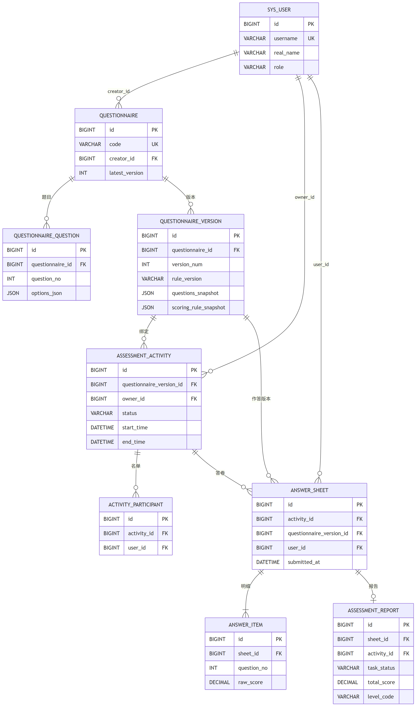
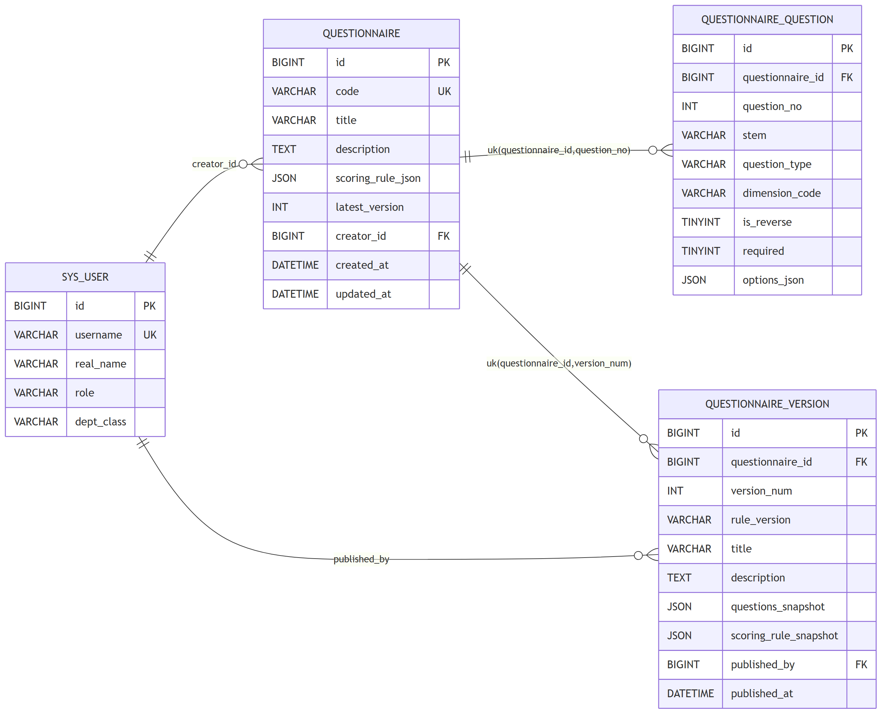
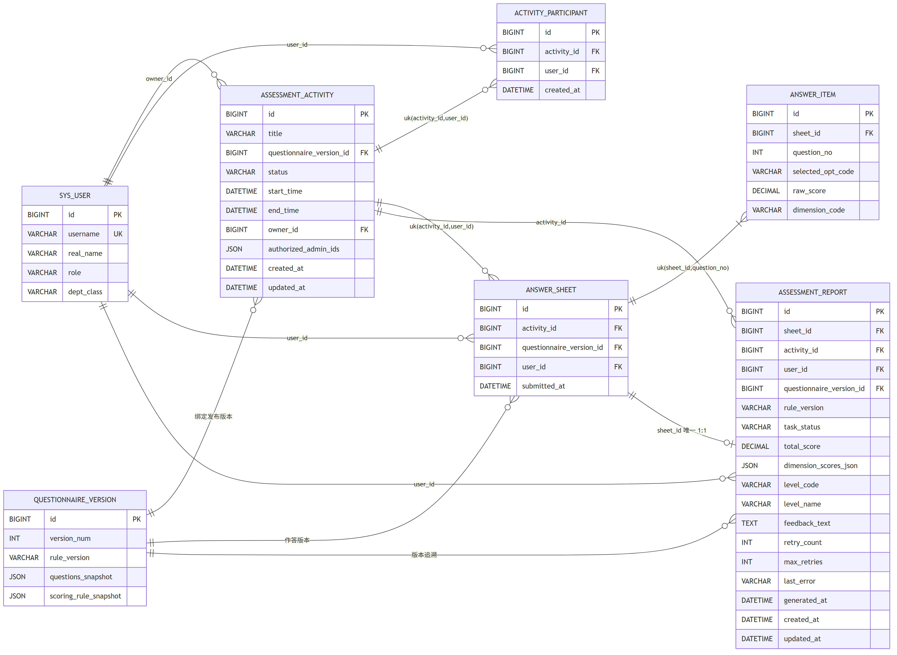

# 数据模型 ER 图（9 张核心表）

> 数据源：`init.sql`（MySQL 8.0 DDL）、`backend/src/main/resources/sql/schema-h2.sql`（H2 兼容 DDL）。
> 可编辑源：`docs/diagrams/*.mmd`；本文档图片均由 `@mermaid-js/mermaid-cli` 从源文件直接导出，图表与 DDL 一一对应。

## 一、全景 ER 图

按业务链路从左到右：**问卷草稿 → 发布版本快照 → 评估活动 → 目标名单 → 有效答卷 → 作答明细 → 评估报告**。

## 二、分域 ER 图

### 2.1 问卷配置与版本域（REQ02 / REQ03）

- `questionnaire` 只存**草稿**，可被反复编辑。
- `questionnaire_version` 是**只读快照**，发布后不再更新，`uk_q_ver(questionnaire_id, version_num)` 保证版本号唯一。
- 历史活动通过 `assessment_activity.questionnaire_version_id` 固定引用快照，改草稿、发新版本都不会影响已发布活动的题目与计分依据。

### 2.2 活动、答卷与报告域（REQ04 / REQ05 / REQ06 / REQ07 / REQ08 / REQ10）

- `activity_participant` 既是参与资格白名单，也是完成率分母。
- `answer_sheet.uk_submit_once(activity_id, user_id)` 是并发重复提交的**数据库级硬防线**，冲突映射为 HTTP 409。
- `answer_item.uk_sheet_q(sheet_id, question_no)` 防止同一份答卷出现重复题号。
- `assessment_report.sheet_id` 唯一，一份答卷最多一份报告，也是 MQ 重复消费的天然幂等键。

## 三、完整数据字典

### 3.1 `sys_user` 系统用户表

| 字段 | 类型 | 约束 | 说明 |
| --- | --- | --- | --- |
| id | BIGINT | PK, AUTO_INCREMENT | 主键 |
| username | VARCHAR(64) | NOT NULL, UNIQUE | 学号 / 工号 |
| password_hash | VARCHAR(128) | NOT NULL | BCrypt 加密口令 |
| real_name | VARCHAR(64) | NOT NULL | 真实姓名 |
| role | VARCHAR(20) | NOT NULL | `ADMIN` 管理人员 / `STUDENT` 参与者 |
| dept_class | VARCHAR(128) | — | 学院 / 班级 |
| phone | VARCHAR(32) | — | 联系电话 |
| status | TINYINT | NOT NULL, DEFAULT 1 | 1 正常 / 0 禁用（禁用后登录返回 401） |
| created_at | DATETIME | NOT NULL, DEFAULT CURRENT_TIMESTAMP | 创建时间 |
| updated_at | DATETIME | NOT NULL, ON UPDATE | 更新时间 |

### 3.2 `questionnaire` 问卷编辑主表（草稿）

| 字段 | 类型 | 约束 | 说明 |
| --- | --- | --- | --- |
| id | BIGINT | PK | 主键 |
| code | VARCHAR(64) | NOT NULL, UNIQUE | 问卷唯一编码 |
| title | VARCHAR(128) | NOT NULL | 标题 |
| description | TEXT | — | 说明 |
| scoring_rule_json | JSON | — | 草稿态计分规则（维度、公式、结果区间） |
| latest_version | INT | NOT NULL, DEFAULT 0 | 最新已发布版本号，0 表示未发布 |
| creator_id | BIGINT | NOT NULL, FK→sys_user.id | 创建人 |
| created_at / updated_at | DATETIME | NOT NULL | 时间戳 |

### 3.3 `questionnaire_question` 问卷草稿题目表

| 字段 | 类型 | 约束 | 说明 |
| --- | --- | --- | --- |
| id | BIGINT | PK | 主键 |
| questionnaire_id | BIGINT | NOT NULL, FK→questionnaire.id | 所属问卷 |
| question_no | INT | NOT NULL | 题号 / 显示顺序 |
| stem | VARCHAR(500) | NOT NULL | 题干 |
| question_type | VARCHAR(20) | NOT NULL, DEFAULT 'SINGLE' | 题型，基础为单选 |
| dimension_code | VARCHAR(64) | NOT NULL, DEFAULT 'DEFAULT' | 归属维度编码 |
| is_reverse | TINYINT | NOT NULL, DEFAULT 0 | 1 表示反向计分 |
| required | TINYINT | NOT NULL, DEFAULT 1 | 1 表示必答 |
| options_json | JSON | NOT NULL | `[{"optCode":"A","label":"从不","score":1,"sort":1}]` |

索引：`idx_q_sort(questionnaire_id, question_no)`。

### 3.4 `questionnaire_version` 版本快照表（只读）

| 字段 | 类型 | 约束 | 说明 |
| --- | --- | --- | --- |
| id | BIGINT | PK | 主键 |
| questionnaire_id | BIGINT | NOT NULL, FK→questionnaire.id | 所属问卷 |
| version_num | INT | NOT NULL | 版本号 1,2,3… |
| rule_version | VARCHAR(32) | NOT NULL | 规则版本标识，如 `R-2026.1` |
| title | VARCHAR(128) | NOT NULL | 发布时标题 |
| description | TEXT | — | 发布时说明 |
| questions_snapshot | JSON | NOT NULL | 冻结的题目与选项分值 |
| scoring_rule_snapshot | JSON | NOT NULL | 冻结的维度、公式、区间定义 |
| published_by | BIGINT | NOT NULL, FK→sys_user.id | 发布人 |
| published_at | DATETIME | NOT NULL | 发布时间 |

唯一键：`uk_q_ver(questionnaire_id, version_num)`。**禁止 UPDATE / DELETE。**

### 3.5 `assessment_activity` 评估活动表

| 字段 | 类型 | 约束 | 说明 |
| --- | --- | --- | --- |
| id | BIGINT | PK | 主键 |
| title | VARCHAR(128) | NOT NULL | 活动名称 |
| questionnaire_version_id | BIGINT | NOT NULL, FK→questionnaire_version.id | 固定绑定的问卷版本 |
| status | VARCHAR(20) | NOT NULL, DEFAULT 'DRAFT' | `DRAFT` / `PUBLISHED` / `CLOSED` |
| start_time / end_time | DATETIME | NOT NULL | 开放时间窗，要求 start < end |
| owner_id | BIGINT | NOT NULL, FK→sys_user.id | 负责管理员 |
| authorized_admin_ids | JSON | — | 额外授权管理员 ID 数组 |
| created_at / updated_at | DATETIME | NOT NULL | 时间戳 |

索引：`idx_owner(owner_id)`。数据范围判定：`currentUserId == owner_id` 或 `authorized_admin_ids` 包含本人。

### 3.6 `activity_participant` 活动目标名单表

| 字段 | 类型 | 约束 | 说明 |
| --- | --- | --- | --- |
| id | BIGINT | PK | 主键 |
| activity_id | BIGINT | NOT NULL, FK→assessment_activity.id | 活动 |
| user_id | BIGINT | NOT NULL, FK→sys_user.id | 目标学生 |
| created_at | DATETIME | NOT NULL | 入名单时间 |

唯一键：`uk_act_user(activity_id, user_id)`；索引：`idx_user_act(user_id, activity_id)`。

### 3.7 `answer_sheet` 有效答卷主表

| 字段 | 类型 | 约束 | 说明 |
| --- | --- | --- | --- |
| id | BIGINT | PK | 主键 |
| activity_id | BIGINT | NOT NULL, FK→assessment_activity.id | 活动 |
| questionnaire_version_id | BIGINT | NOT NULL, FK→questionnaire_version.id | 作答时的版本 |
| user_id | BIGINT | NOT NULL, FK→sys_user.id | 提交学生 |
| submitted_at | DATETIME | NOT NULL, DEFAULT CURRENT_TIMESTAMP | 提交时间 |

唯一键：`uk_submit_once(activity_id, user_id)` —— **并发防重的核心约束**。

### 3.8 `answer_item` 答卷作答明细表

| 字段 | 类型 | 约束 | 说明 |
| --- | --- | --- | --- |
| id | BIGINT | PK | 主键 |
| sheet_id | BIGINT | NOT NULL, FK→answer_sheet.id | 所属答卷 |
| question_no | INT | NOT NULL | 题号 |
| selected_opt_code | VARCHAR(32) | NOT NULL | 所选选项编码 |
| raw_score | DECIMAL(8,2) | NOT NULL | 按快照与正反向规则换算后的得分 |
| dimension_code | VARCHAR(64) | NOT NULL | 维度编码 |

唯一键：`uk_sheet_q(sheet_id, question_no)`。与 `answer_sheet` 同事务写入，任一失败整单回滚。

### 3.9 `assessment_report` 评估报告与异步任务表

| 字段 | 类型 | 约束 | 说明 |
| --- | --- | --- | --- |
| id | BIGINT | PK | 主键 |
| sheet_id | BIGINT | NOT NULL, **UNIQUE**, FK→answer_sheet.id | 一份答卷一份报告（幂等键） |
| activity_id | BIGINT | NOT NULL | 所属活动 |
| user_id | BIGINT | NOT NULL | 报告归属学生 |
| questionnaire_version_id | BIGINT | NOT NULL | 问卷版本追溯 |
| rule_version | VARCHAR(32) | NOT NULL | 计分规则版本追溯 |
| task_status | VARCHAR(20) | NOT NULL, DEFAULT 'PENDING' | `PENDING` / `SUCCESS` / `FAILED` |
| total_score | DECIMAL(8,2) | — | 总分（SUCCESS 时写入） |
| dimension_scores_json | JSON | — | 各维度得分 |
| level_code / level_name | VARCHAR(64) | — | 结果区间编码与名称 |
| feedback_text | TEXT | — | 反馈建议 |
| retry_count | INT | NOT NULL, DEFAULT 0 | 已重试次数 |
| max_retries | INT | NOT NULL, DEFAULT 3 | 重试上限 |
| last_error | VARCHAR(500) | — | 最近失败原因 |
| generated_at | DATETIME | — | 报告生成时间 |
| created_at / updated_at | DATETIME | NOT NULL | 时间戳 |

索引：`idx_act_status_level(activity_id, task_status, level_code)`、`idx_user_report(user_id)`。
统计口径：只有 `task_status = 'SUCCESS'` 的记录参与结果区间分布，`PENDING` / `FAILED` 单独计数。

## 四、关系与约束一览

| 关系 | 基数 | 关联字段 | 说明 |
| --- | --- | --- | --- |
| sys_user → questionnaire | 1:N | creator_id | 管理员创建问卷草稿 |
| sys_user → questionnaire_version | 1:N | published_by | 发布人 |
| questionnaire → questionnaire_question | 1:N | questionnaire_id | 草稿题目 |
| questionnaire → questionnaire_version | 1:N | questionnaire_id | 发布版本，`uk_q_ver` 唯一 |
| questionnaire_version → assessment_activity | 1:N | questionnaire_version_id | 活动固定绑定版本 |
| sys_user → assessment_activity | 1:N | owner_id | 负责管理员 |
| assessment_activity → activity_participant | 1:N | activity_id | 目标名单 |
| sys_user → activity_participant | 1:N | user_id | 名单学生 |
| assessment_activity → answer_sheet | 1:N | activity_id | 一人一卷（含 user_id 联合唯一） |
| sys_user → answer_sheet | 1:N | user_id | 本人答卷 |
| questionnaire_version → answer_sheet | 1:N | questionnaire_version_id | 作答版本追溯 |
| answer_sheet → answer_item | 1:N | sheet_id | 作答明细 |
| answer_sheet → assessment_report | 1:1 | sheet_id（UNIQUE） | 一份答卷一份报告 |
| assessment_activity → assessment_report | 1:N | activity_id | 活动报告 |
| questionnaire_version → assessment_report | 1:N | questionnaire_version_id | 版本追溯 |
| sys_user → assessment_report | 1:N | user_id | 报告归属 |

## 五、设计要点

1. **逻辑外键而非物理外键**：DDL 未声明 `FOREIGN KEY`，关联由应用层与索引维护，便于教学环境分批初始化与重置数据；关系完整性由 Service 层校验 + 唯一索引兜底。
2. **快照不可变**：`questionnaire_version` 只插入不更新，历史活动、答卷、报告始终能还原当时的题目、分值与区间，满足「改题目后历史结果可复核」。
3. **三处唯一索引承担业务约束**：
   - `uk_submit_once` → 并发重复提交 → HTTP 409；
   - `uk_sheet_q` → 同卷重复题号；
   - `assessment_report.sheet_id UNIQUE` → MQ 重复消费天然幂等。
4. **JSON 字段按冻结结构存储**：题目与选项分值整体落 JSON，H5 直接按返回结构动态渲染，题目调整无需改动前端代码。
5. **统计口径与状态解耦**：任务状态（PENDING / SUCCESS / FAILED）与结果区间分离存储，避免未完成报告被误计入分数分布。
